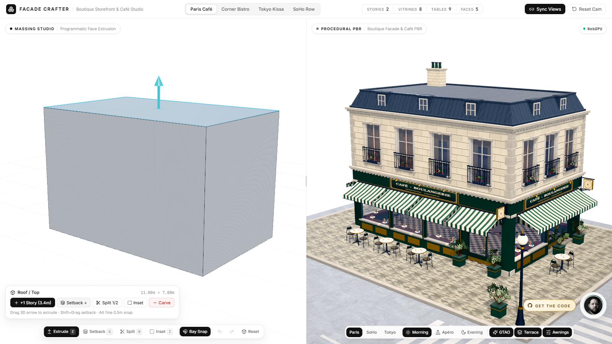
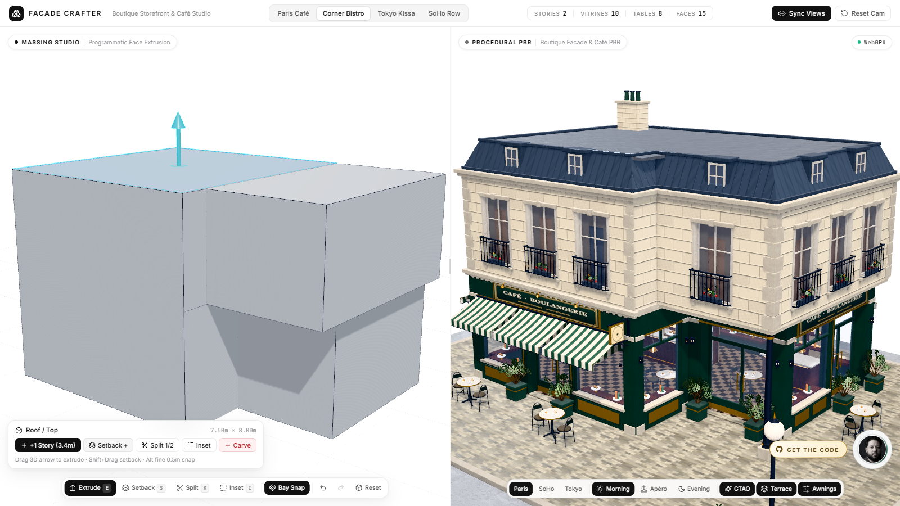
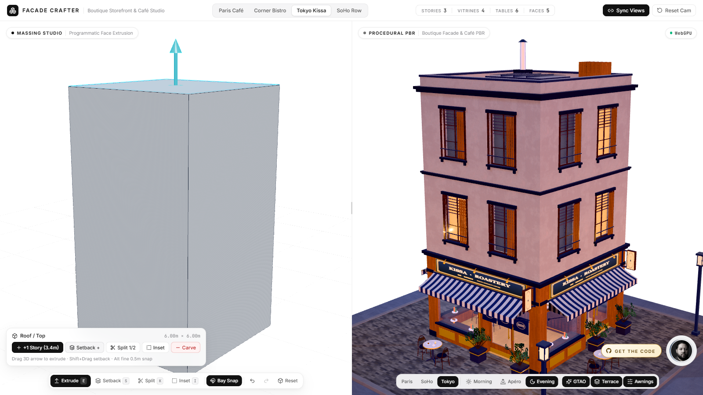
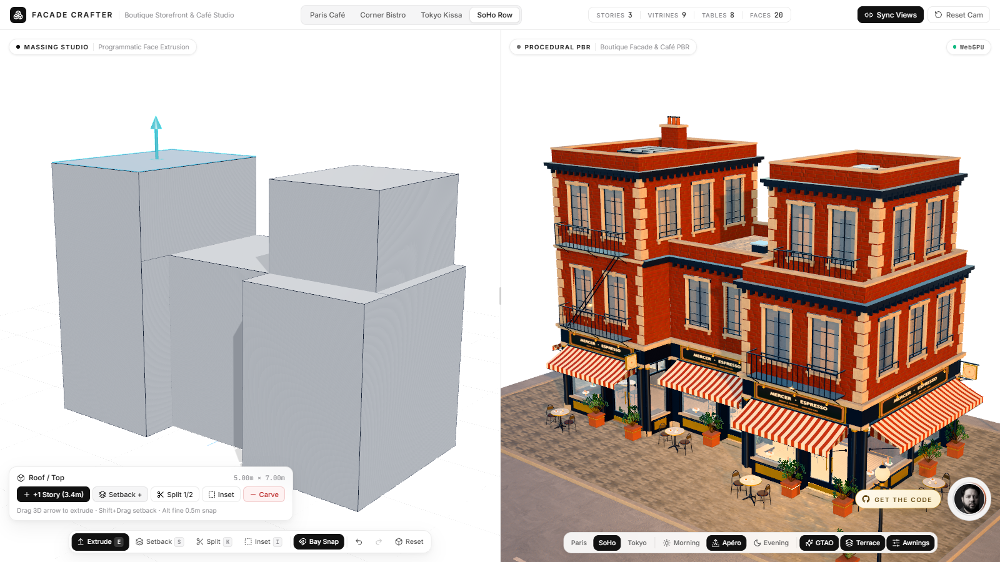

# Facade Crafter

**Boutique storefront & café facades, generated live in Three.js WebGPU.**

Sketch a building as simple boxes on the left, and see it turned into a fully detailed storefront on the right in real time, with awnings, vitrines, balconies, terrace tables, signage and PBR materials.

**Repository:** [github.com/achrefelouafi/Facade-crafter-threejs](https://github.com/achrefelouafi/Facade-crafter-threejs)



## Features

- **Massing Studio**: extrude, set back, split, inset and carve faces directly in 3D, with bay and story snapping.
- **Procedural PBR facade**: every massing change regenerates the storefront — stories, vitrines, cornices, roofs and street furniture.
- **Presets**: Paris Café, Corner Bistro, Tokyo Kissa and SoHo Row.
- **Styles**: Paris, SoHo and Tokyo material palettes.
- **Lighting moods**: Morning, Apéro and Evening, with optional GTAO.
- **Toggles**: terrace seating and awnings, plus synced cameras between both views.

## Screenshots

| Corner Bistro | Tokyo Kissa · Evening |
| --- | --- |
|  |  |

| SoHo Row · Apéro |
| --- |
|  |

## Getting started

Requires Node.js 18+ and a browser with WebGPU support (recent Chrome or Edge).

```bash
git clone https://github.com/achrefelouafi/Facade-crafter-threejs.git
cd Facade-crafter-threejs
npm install
npm run dev
```

Then open http://localhost:5188.

| Script | What it does |
| --- | --- |
| `npm run dev` | Start the Vite dev server |
| `npm run build` | Type-check and build to `dist/` |
| `npm run preview` | Serve the production build |

## Controls

| Key | Tool |
| --- | --- |
| `E` | Extrude (drag the 3D arrow) |
| `S` | Setback (or Shift + drag) |
| `K` | Split |
| `I` | Inset |
| `Alt` | Fine 0.5 m snap while dragging |

## Tech stack

React 19 · TypeScript · Vite · Three.js (WebGPU renderer) · lucide-react

## License

[MIT](LICENSE)
